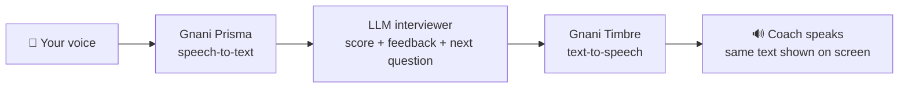

# 🎤 Voice Interview Coach

**Practise job and internship interviews out loud, in English, Hinglish and Kannada, and get instant spoken feedback.**


Built for the **Great Indian AI Internship Challenge** by Gnani AI.
`#GnaniAI` `#GreatIndianAIInternshipChallenge`

---

## 📌 Why I built this

Interview practice is hard to come by. Most students have nobody to practise with, and almost no tool lets you practise in the language you actually think in. I wanted a coach that **listens to my spoken answer, understands it, and talks back**, and that works in English, Hinglish (Hindi and English mixed) and Kannada.

Gnani's speech models are made for Indian languages, so they were a natural fit. I built this project to learn how to connect speech recognition, a language model and speech synthesis into one real application, and to make something I would genuinely use to prepare for my own interviews.

## 🎬 Demo

- **Demo video:** _paste your LinkedIn or X post link here_

| Dashboard | Interview | Performance |
|---|---|---|
|  |  |  |

## ✨ Features

**Voice interview**
- Speak your answer with the microphone (or upload a recording) and hear the coach reply in a natural voice
- The coach asks **one question at a time** and adapts follow-up questions to what you just said
- Three languages: **English**, **Hinglish** and **Kannada**
- The text on screen is exactly what the voice says, so you can read along
- Adjustable speaking speed

**Interview setup**
- 5 interview types: Technical, HR, Behavioural, Coding and General
- 3 difficulty levels: Beginner, Intermediate and Advanced
- 20 internship and job roles to pick from, or type your own
- Choose 3 to 10 questions per interview

**Feedback and progress**
- Every answer gets a **score out of 10** and a short piece of feedback
- Dashboard with your interview count, questions answered, average score, best score, recent interviews and a score trend
- Performance page with a bar for each answer, plus your strongest and weakest answers
- History of past interviews: click any one to read every question, answer and score

**Personalised practice**
- Upload your **resume (PDF)**, add your **public GitHub** username and paste your **LinkedIn** text
- The coach finds your skills and projects and asks about them, and gives **tips to improve your resume**

**Accounts and appearance**
- Sign up and sign in with email and password, or continue as a guest
- Interviews are saved to your account
- Three colour themes: Dark Neon, Light and Midnight Blue

## 🧠 How it works



1. **Prisma** turns my recorded answer into text.
2. The **LLM** acts as the interviewer. In one call it scores my answer, gives one sentence of feedback and writes the next question.
3. **Timbre** reads the reply aloud, and the same text appears on screen.
4. After the last question the interview is saved to my history and dashboard.

## 🛠️ Tech stack

| Part | Technology |
|---|---|
| Language | Python |
| Interface | Gradio |
| Speech-to-text | Gnani **Prisma** (`prisma-v3.0`) |
| Text-to-speech | Gnani **Timbre** (`timbre-v3.0`) |
| Language model | Any OpenAI-compatible API (I use `openai/gpt-oss-120b` on Groq) |
| Accounts and history | SQLite, with PBKDF2-SHA256 password hashing |
| Resume reading | `pypdf` |
| Configuration | `python-dotenv` |
| Tests | `pytest` |

## 🚀 Getting started

### Prerequisites
- Python 3.10 or newer
- A Gnani AI API key (from the challenge platform)
- An API key for an OpenAI-compatible language model
- A microphone, and Chrome, Edge or Firefox

### 1. Get the code
```bash
git clone https://github.com/<your-username>/<your-repo-name>.git
cd <your-repo-name>
```

### 2. Create a virtual environment and install
```bash
python -m venv .venv

# Windows
.venv\Scripts\activate
# macOS / Linux
source .venv/bin/activate

pip install -r requirements.txt
```

### 3. Add your keys
Copy `.env.example` to a new file named `.env` and fill it in:

```bash
# Windows
copy .env.example .env
# macOS / Linux
cp .env.example .env
```

| Setting | What it is |
|---|---|
| `GNANI_API_KEY` | Your Gnani API key |
| `LLM_API_KEY` | Key for your language model provider |
| `LLM_BASE_URL` | Provider URL, e.g. `https://api.groq.com/openai/v1` |
| `LLM_MODEL` | Model name, e.g. `openai/gpt-oss-120b` |
| `LLM_REASONING_EFFORT` | Optional. `low` makes gpt-oss models answer faster |
| `VOICE_ENGLISH`, `VOICE_HINGLISH`, `VOICE_KANNADA` | Voice names from the Gnani Voice Catalog |
| `APP_DB_PATH` | Optional. Where accounts and history are stored (default `users.db`) |

> Keep `.env` private. It is already listed in `.gitignore`.

### 4. Check that each service works (optional but useful)
```bash
python test_apis.py
```
This tests the language model and text-to-speech in all three languages. Add a recording to test speech-to-text too: `python test_apis.py my_clip.wav`.

### 5. Run the app
```bash
python app.py
```
Open **http://127.0.0.1:7860** in your browser. Use this exact address, because browsers only allow microphone access on it.

### Run the tests
```bash
pip install pytest
python -m pytest
```
The 27 tests cover reply parsing, accounts, password security, resume reading and the GitHub reader. None of them call a paid API.

## 📖 Using the app

1. **Sign up** with an email and password, or choose **Continue as guest**.
2. *(Optional)* Open **Profile & Resume**, upload your resume, add your GitHub username and click **Analyse my profile**.
3. Open **New Interview**, pick a language, role, interview type, difficulty and number of questions, then click **Start Interview**.
4. Listen to the question, record your answer, press **Stop**, wait for the ✅ message, then click **Submit Answer**.
5. Read your score and feedback, and answer the next question.
6. Check **Dashboard**, **History** and **Performance** to see how you are improving.

## 📁 Project structure

```
├── app.py                 # The Gradio screen and its events
├── services.py            # Gnani speech-to-text, text-to-speech and LLM calls
├── prompts.py             # Instructions sent to the language model
├── interview.py           # Reading AI replies, sessions, history, statistics
├── candidate_profile.py   # Resume, GitHub and LinkedIn text -> skills, projects, tips
├── auth.py                # Accounts and saved history (SQLite)
├── views.py               # Dashboard, history and performance content
├── styles.py              # Themes and styling
├── config.py              # Settings and options
├── test_apis.py           # Quick check of each external service
├── tests/                 # Automated tests
├── requirements.txt
├── .env.example           # Template for your keys
└── .gitignore
```

I kept the API calls, the interview logic and the screen in separate files, so each part can be tested and changed on its own.

## 🔒 Privacy and security

- **Passwords** are never stored. Only a salted PBKDF2-SHA256 hash is saved, and an account is locked for a few minutes after five wrong attempts.
- **API keys** live in `.env`, which is excluded from Git. The database file `users.db` is excluded too.
- **Resumes** are read in memory and the uploaded file is deleted afterwards. Email addresses and phone numbers are removed before any text reaches the language model, and only a short summary is kept for the session.
- **Profile text is treated as data.** Text from a resume or GitHub is sent to the model as information, never as instructions.
- **Delete my account** in Settings removes your account and saved interviews.

## ⚠️ Limitations

I would rather be upfront about what this project does not do:

- **Scores are AI estimates** based on the words I say. They do **not** measure my voice, tone, confidence or body language.
- Accounts are stored in a local file. There is **no email verification and no password reset**, so it is meant for running on your own computer, not for public hosting.
- **LinkedIn** does not allow apps to read profiles, so you paste your text yourself. GitHub is read through its official public API.
- One answer can be up to about 55 seconds, because of the speech API's file limit.
- Voice quality for Hinglish and Kannada depends on the voice you choose in the Gnani Voice Catalog.

## 🌱 What I learned

- **Models don't always follow the format you ask for.** The AI sometimes returned slightly broken data, and my app read it out loud. I fixed it with a tolerant parser, an automatic retry, and a rule that raw data is never sent to the voice.
- **Fancy effects can break usability.** A card that tilted with the mouse made buttons slip away from the cursor, so I moved that effect to the background.
- **Libraries change.** A Gradio update removed an option I used, which taught me to test against the current version.
- **Test the edges, not just the happy path:** bad passwords, empty recordings, scanned PDFs, unreachable APIs and broken AI replies.

## 🔭 Ideas for the future

- Export an interview report as a PDF
- More Indian languages
- Hosted deployment with email verification and password reset
- Feedback on speaking pace and filler words from the audio itself

## Acknowledgements

- **Gnani AI** for the Prisma and Timbre speech models and for the Great Indian AI Internship Challenge
- The **Gradio** team for making a Python interface this quick to build

## 👩‍💻 About me

I'm **Veena**, a student who enjoys building practical AI projects.

- LinkedIn: https://www.linkedin.com/in/veena-24b76b334/
- GitHub: https://github.com/Veena006
- Email: veenaaili06@gmail.com

---
*If you try the app, I'd love to hear what you think.*
